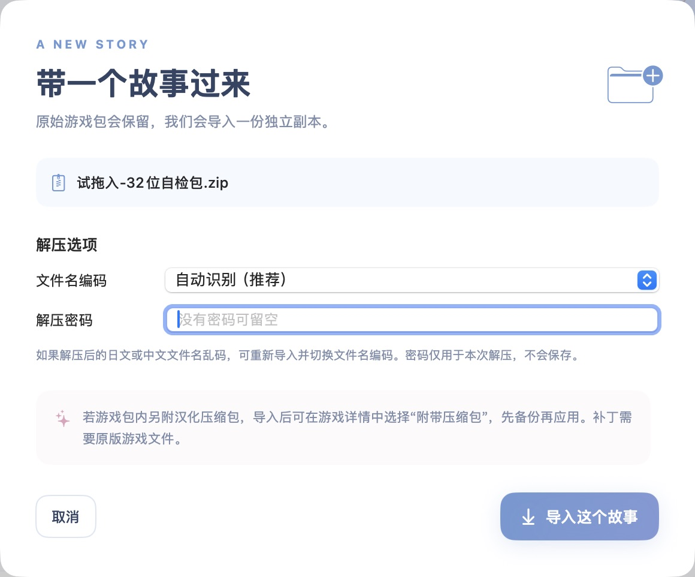
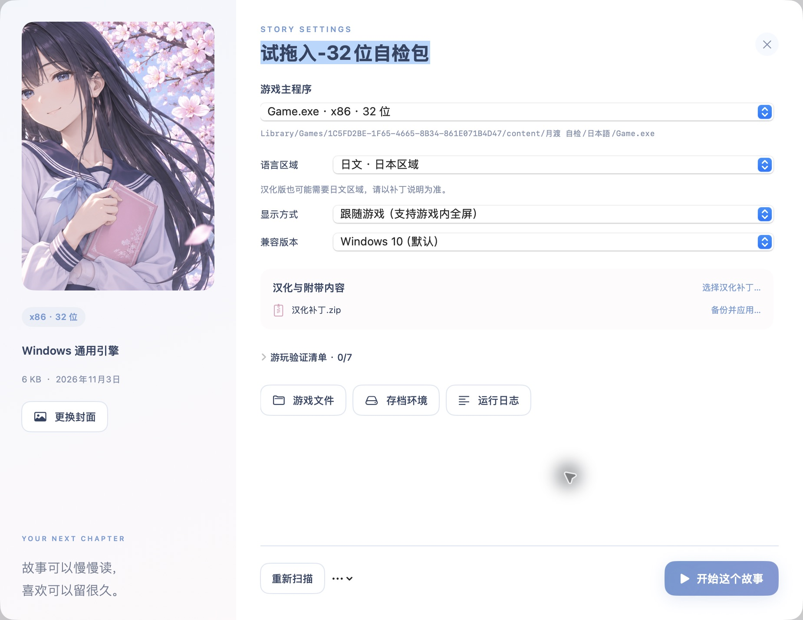

# MoonBridge 月渡

**原生 macOS Galgame 游戏库、兼容运行与可选 AI 资料助手。**

一个使用 SwiftUI 编写的原生 macOS Galgame 导入、启动与兼容验证工具。淡蓝与淡粉的界面、水彩主题插画、本地游戏库，以及按游戏保存的独立运行配置。


> 当前版本 **0.2.1**，属于可构建、可实际验证游戏的早期版本。Windows 游戏通过 **Wine 11 / WoW64 + Apple Rosetta 2** 运行；兼容性需要逐款确认。它不会把任意 EXE 转换成原生 ARM 应用。

## 能做什么

| 功能 | 当前行为 |
| --- | --- |
| 导入游戏 | ZIP、7Z、RAR、完整游戏文件夹；选择 EXE 时复制其所在完整目录 |
| 解压设置 | 解压密码、日文 / 中文文件名编码；密码不写入游戏库 |
| 寻找主程序 | 检查 PE 头、识别 x86 / x64，区分游戏候选、安装器和配置工具 |
| 运行环境 | 每款游戏独立 Wine 前缀、语言区域、Windows 兼容版本与显示设置 |
| 窗口与全屏 | 跟随游戏自己的全屏选项；异常时可选固定分辨率虚拟桌面 |
| 汉化补丁 | 发现附带压缩包；先备份同名文件，再覆盖并重新扫描启动器 |
| 游戏库 | 封面网格、继续游玩、排序搜索、独立本地游戏主页、运行设置与游玩验证清单 |
| 游戏资料 | 联网检索真实作品候选，确认后缓存封面与简介，支持手动编辑与中文整理 |
| 千咲与记忆 | 游戏库管理员角色、手绘 Q 版头像、跨游戏 SQLite 长期记忆、默认折叠历史、事项管理与本地检索 |
| 模型连接 | 独立 API 地址与 Key、获取接口模型列表、选择模型和推理强度、可选联网来源与取消回答 |
| 排错 | 本地日志、组件诊断、打开游戏目录与存档环境、仅停止所选游戏前缀 |
| 专项兼容 | 附带《纸上的魔法使》的 KiriKiri Z 迁移脚本与修复说明，需自行提供匹配版本资源 |

“引擎识别”只是文件特征分类，不代表已经验证兼容。KiriKiri Z 是一个额外的 **Windows 游戏引擎**，仍由同一个 Wine 后端启动，不是第二套 CPU 转译器。

## 从源码开始

需要 Apple Silicon Mac、Apple Command Line Tools / Swift、Python 3，以及支持 Rosetta 2 的 macOS。界面源码最低目标为 macOS 14；实际验证平台与边界见 [验证记录](docs/VALIDATION.md)。无需第三方 Swift 包，也无需安装 Windows 系统。

将仓库放在自己确认不参与云同步的目录中，例如 `~/Local Games/MoonBridge`，然后执行：

```sh
git clone https://github.com/avalon-lune/MoonBridge.git
cd MoonBridge
python3 scripts/bootstrap-runtime.py
bash scripts/build.sh
open MoonBridge.app
```

运行组件按固定版本下载并校验 SHA-256，保存在项目的 `Runtime` 内。Rosetta 是 Apple 的系统组件，需要用户按 Apple 提示单独准备；脚本不会自动安装或替用户接受其许可。构建使用本地 ad-hoc 签名，当前没有公证的公开安装包。

**保留 `MoonBridge.app`、`Runtime` 和 `Library` 位于同一个项目根目录。** 不要只把 App 单独拖到其他目录。详细步骤见 [构建与运行](docs/BUILD.md)。

## 第一次导入

1. 把完整游戏压缩包或文件夹拖进窗口，或点击“导入游戏”。
2. 有密码时填写密码；文件名乱码时重新导入并选择匹配的文件名编码。
3. 确认“游戏主程序”，汉化包通常需要选择随包提供的中文启动器。
4. 按游戏说明选择区域，点击“开始游戏”。首次创建运行环境需要等待。
5. 实际检查中文、画面、声音和视频，再保存并读取一次进度。





首页截图来自 0.2.1 本地界面；装饰插画使用内置图像工具生成，真实封面来自选中的公开资料来源。其余两张为早期导入和运行设置参考。截图不包含商业游戏本体、汉化资源包或个人存档，主题角色权利归原权利人。

## 本地数据与网络

```text
MoonBridge/
├── MoonBridge.app       # 构建后的原生界面
├── Runtime/             # Wine、7-Zip、GStreamer，可选 KiriKiri Z
├── Library/
│   ├── Games/           # 已导入的完整游戏副本
│   ├── Prefixes/        # 按游戏独立的 Windows 环境
│   ├── Backups/         # 应用补丁前保存的同名原文件
│   ├── Logs/            # 运行日志
│   └── Companion/       # 资料、封面、AI 设置与问答（与游戏资源分开）
└── Sources/             # 软件源码
```

成功导入后，游戏从 `Library` 中的副本运行，不依赖原下载 ZIP。存档由游戏写入，可能在游戏目录，也可能在对应前缀的 Windows 用户目录；备份时需要同时考虑 `Games` 与 `Prefixes`。补丁备份不等于每次存档都会自动备份。

导入与游戏启动不需要 AI。可选资料匹配会发送检索名称；千咲问答会向设置中的服务发送当前问题、有限历史、相关共享记忆片段与选中的游戏资料。游戏本体、存档与 Wine 日志不会作为请求内容。API Key 保存在 macOS 钥匙串，不保存在 Library JSON 或源码中。关闭联网功能后可继续本地导入和运行。首次获取运行组件需要联网；第三方游戏自身的联网行为，以及 iCloud / 其他同步软件，仍各自独立。更详细的目录安排见 [存储与迁移](docs/STORAGE.md)。

## AI 配置

打开侧栏的“AI 设置”，填写 API 地址与 API Key，保存后可刷新当前接口的模型列表，选择模型和推理强度，再保存并测试连接。支持兼容 Responses 的 HTTPS 服务，默认 OpenAI `gpt-6.1-terra`。密钥按 API 地址分别保存在钥匙串；更换地址后需要为新地址配置凭据。新安装不自带任何密钥。可选配置本机 HTTP / SOCKS5 代理。

在游戏主页点击“匹配资料”，确认真实作品后再保存。中文整理依据选中来源，不读取游戏脚本；没有资料或来源不足时，AI 可能无法回答具体剧情或攻略。联网问答会显示可点击来源，无法保证覆盖所有作品或完全避免剧透。详见 [资料与 AI 助手](docs/COMPANION.md)。

## 兼容性与限制

- 已有《天津罪》的中文与旧存档读取确认，以及《纸上的魔法使》专项修复后的中文、声音、新存读档确认。完整路线与所有视频没有全部验证，详见 [验证记录](docs/VALIDATION.md)。
- 原生 GUI 不代表游戏原生运行；当前只有一个 Wine 后端。**ARM 原生 Wine + FEX 尚未接入。** macOS 28 之后不能假定当前 Rosetta 方案继续适用。
- DRM、内核驱动、特定 VC++ / .NET 依赖、私有插件与特殊视频格式需要逐款处理。独立 Wine 前缀属于配置隔离，不是安全沙箱。
- 多层压缩包、分卷及伪装扩展名文件不提供一键自动修复；请先整理成完整游戏文件夹再导入。
- KiriKiri Z 修复针对匹配哈希的特定游戏版本，不会自动替换新导入游戏的引擎。

## 开发与自检

```sh
bash scripts/build.sh
./build/swift/release/MoonBridgeCompanionCheck
./build/swift/release/MoonBridgeMemoryCheck
./build/swift/release/MoonBridgeCheck "$PWD"
./build/swift/release/MoonBridgeCheck "$PWD" --runtime
```

自检使用本项目生成的极小 Win32 / Win64 程序。`--runtime` 会真正执行两个 Windows 进程并检查退出码；其通过不代表任意商业游戏都兼容。也可以把根目录两个“试拖入” ZIP 导入 GUI。自检源码与生成器均包含在仓库内。

| 文档 | 内容 |
| --- | --- |
| [使用说明](docs/USAGE.md) | 导入、汉化、显示、存档与排错 |
| [构建与运行](docs/BUILD.md) | 工具链、固定运行库、重建、自检 |
| [架构](docs/ARCHITECTURE.md) | GUI、Wine、Rosetta、游戏引擎与数据流 |
| [验证记录](docs/VALIDATION.md) | 实测结果与未验证项目 |
| [专项修复记录](docs/compatibility/PAPER_MAGICIAN.md) | KiriKiri Z、编码覆盖层、回退与复现 |
| [第三方组件](THIRD_PARTY.md) | 版本、来源与许可边界 |
| [更新记录](CHANGELOG.md) | 当前版本变更 |

项目原始源码与自检生成器采用 [MIT License](LICENSE)。第三方组件保留各自许可。仓库提供软件源码、素材与重建方法，不提供商业游戏及其下载。
