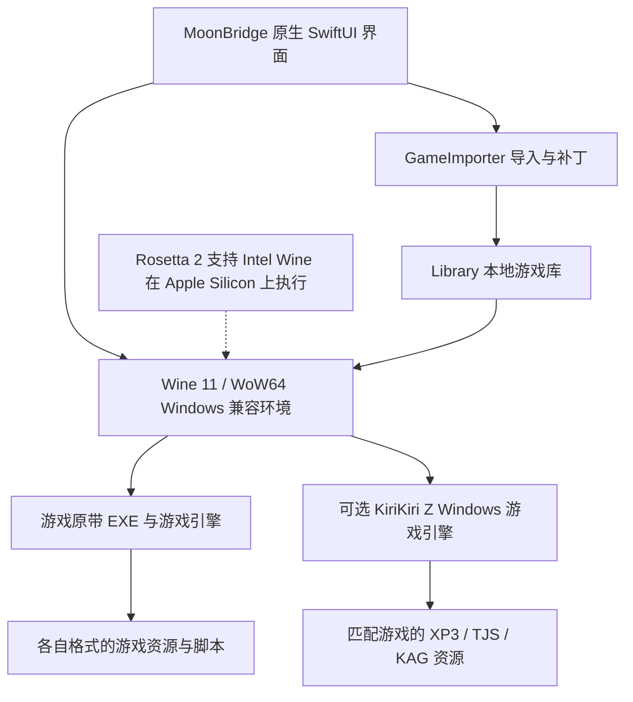

# 运行架构 / 0.1.1

MoonBridge 是原生 SwiftUI 启动器，管理游戏副本、运行配置与验证记录。它不把任意 Windows EXE 转换成 macOS ARM 原生程序。

## 层次与边界

| 层 | 当前实现 |
| --- | --- |
| 原生应用 | SwiftUI、AppKit 与 Foundation |
| Windows API 兼容 | 一个固定的 Wine stable 11.0 后端，使用 WoW64 运行 Windows x86 32 位程序 |
| Intel 指令转译 | Apple Rosetta 2，系统管理 |
| 游戏资源与脚本 | 游戏自己的引擎；专项配置可改由 KiriKiri Z 加载对应资源 |

例如《天津罪》使用游戏包原带的 CMVS；《纸上的魔法使》专项配置使用新加入的 KiriKiri Z。两者最终走相同的 `WineEngine.launchAndWait`，没有第二套底层转译器，也没有通用的原生 KiriKiri 后端。

`MoonBridgeCore` 不依赖 GUI。`WineEngine` 提供 prepare、launchAndWait、stop、openConfiguration 与 check，是未来更换运行底座的主要边界。当前后端路径仍为固定 Wine 目录；ARM Wine / FEX 需要后续实现、适配和回归，尚未包含在此版本。

## 导入与数据流

1. NSOpenPanel、Finder 文档打开或文件 URL 拖放进入 AppModel。
2. GameImporter 先在新 UUID 目录暂存。压缩包先列目录，拒绝路径逃逸与链接，解压成功后再提交；文件夹则完整复制。
3. GameScanner 检查 PE 头，识别 x86 / x64 / ARM64，按规则排序主程序、安装器和辅助程序；当前拒绝 ARM64 Windows 候选。
4. LibraryDocument 以 JSON 原子保存相对路径、配置、人工验证清单与会话状态。
5. WineEngine 为每款游戏建立独立 64 位前缀，提供 WoW64。注册区域、编码页与字体替代，映射游戏副本为 G:，将 Wine 自动创建的用户目录链接改为前缀内本地目录。
6. G: 使用相对链接，即使准备缓存有效也会检查映射，避免整体搬家后仍指向旧目录。
7. 以 EXE 所在目录为工作目录启动，输出写入本地日志；wineserver 跟踪子进程，停止操作仅针对当前 WINEPREFIX。
8. 相同配置复用已准备的环境。进程退出结果与人工游玩验证分别记录，避免把“启动过”当作“兼容通过”。

## 补丁

文件覆盖型补丁先解压到缓存，检查路径后覆盖当前 EXE 所在目录；同名原文件保存到时间戳备份。自定义安装器仍需遵照自己的流程，不是通用安装器模拟。原下载包不会被修改，但导入副本会按用户指令应用补丁。

KiriKiri Z 专项修复另见 [迁移记录](compatibility/PAPER_MAGICIAN.md)。资源和汉化由用户自己的游戏包提供，仓库仅提供处理脚本。

## 本地存储与限制

App、Runtime 和 Library 位于同一根目录。源代码、下载缓存和构建产物均可保存在项目内；Rosetta 与开发者工具属于系统组件。独立前缀不是安全沙箱，Windows 程序仍以当前用户权限执行。

本版本没有通用 DRM 绕过、通用引擎替换、全部视频修复、云存档或后台上传服务。字体使用 macOS 本地替代，不分发微软字体。游戏兼容结论应以真实画面、音频、视频和存读档测试为准。
