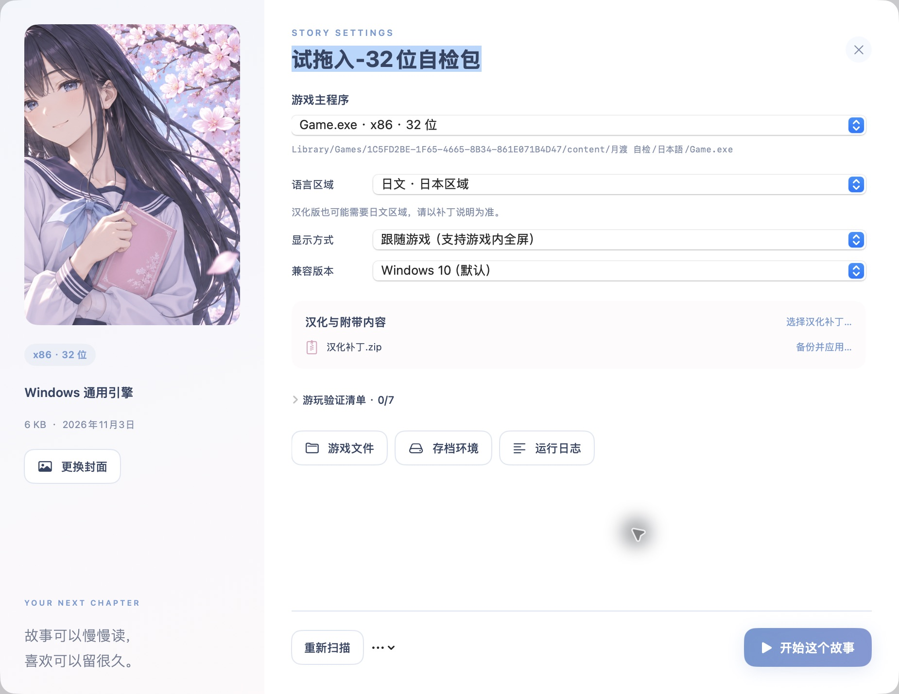

# 月渡使用说明

## 导入完整游戏

拖入 ZIP / 7Z / RAR 或完整游戏文件夹，或使用“导入游戏”选择。单独选择 EXE 时会复制其所在文件夹，所以请先将一款游戏整理成独立目录，不要选择下载目录、桌面等宽泛位置。

导入窗口支持解压密码和文件名编码。密码只用于当次解压，不保存到游戏库；密码也不是汉化开关。文件名编码解决解压后的名称乱码，语言区域影响程序运行，两者不同。


已经成功导入的游戏从 `Library/Games/<游戏ID>/content` 运行。原下载包可以另行归档；删除原下载包不会自动删除已导入副本。文件夹导入也会复制，原文件夹后续变化不会自动同步到库中。

伪装成 MP4、套多层压缩或 `.7z.001` 一类分卷，应先使用可信工具整理成完整游戏目录。当前 GUI 不自动剥离视频载体或逐层展开任意嵌套包。DLC 安装器和本篇也不一定是两款独立游戏，应以随包说明为准。

## 主程序、区域与显示

详情页可以修改显示名称，不必修改实际 EXE 文件名。先选本体或随包提供的中文启动器，避免误选配置工具、卸载器、依赖安装器或 DLC 更新器。

- 已汉化不意味着一定必须使用中文区域；有的补丁仍要求日文区域。
- 区域不会凭空切换原版和汉化版；实际语言取决于启动程序、资源、补丁及游戏设置。
- “跟随游戏”使用游戏自己的窗口 / 全屏选项；部分程序支持 Alt + Enter。
- 黑屏、窗口尺寸或输入坐标异常时，可以尝试“虚拟桌面”和明确的分辨率。它不是保证填满 Mac 屏幕的通用缩放器。
- Windows 10 / 7 / XP 是 Wine 兼容版本设置，不会安装对应操作系统。



## 应用汉化与追加补丁

详情页会列出附带压缩包，也可选择外部补丁。“备份并应用”会将文件覆盖到当前选中 EXE 所在目录，并先备份同名原文件。

```text
Library/Backups/<游戏ID>/patch-<时间>/
```

如果补丁有一层包装文件夹，导入器会尝试剥离；目标位置仍应与补丁说明一致。需要安装器、注册或特殊步骤的补丁，应按随包说明处理，不能用文件覆盖替代所有安装过程。失败时先看日志和已生成备份，避免盲目重复覆盖。

《纸上的魔法使》另有 [针对性迁移说明](compatibility/PAPER_MAGICIAN.md)，不适用于全部 KiriKiri 游戏。

## 存档、退出与备份

存档由游戏写入，不是月渡统一接管。常见位置为游戏目录的 `save` / `savedata`，或 `Library/Prefixes/<游戏ID>/drive_c/users` 下的应用数据目录。

游戏内存档后再退出。月渡的停止按钮会结束相应前缀内的进程，不能替代保存。游戏运行时退出月渡会提示处理运行中的会话。

“从游戏库隐藏”只移除列表条目，保留文件。应用补丁时的原文件备份、手动存档快照与游戏自身存档是不同东西；当前没有每次存档后自动生成额外快照的功能。

## 验证一次实际游玩

依次检查文字、立绘、音乐、语音、OP / ED 视频与存读档，在“游玩验证清单”手动记录。进程成功启动或正常退出不会自动被标记为整款游戏兼容通过。

遇到问题时先记录当前 EXE、区域、兼容版本和显示方式，再打开对应日志。运行环境页检查 Wine、Rosetta 与 7-Zip；游戏详情提供游戏文件、存档环境和运行日志入口。提交公开问题时，去除本机用户名、私人路径和存档内容。
